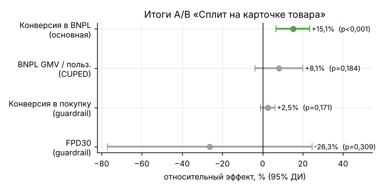
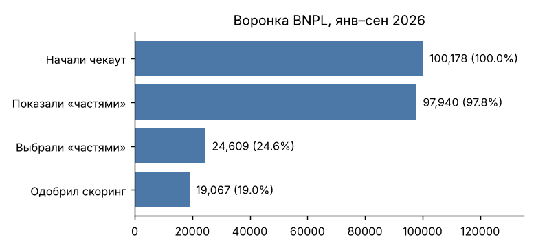
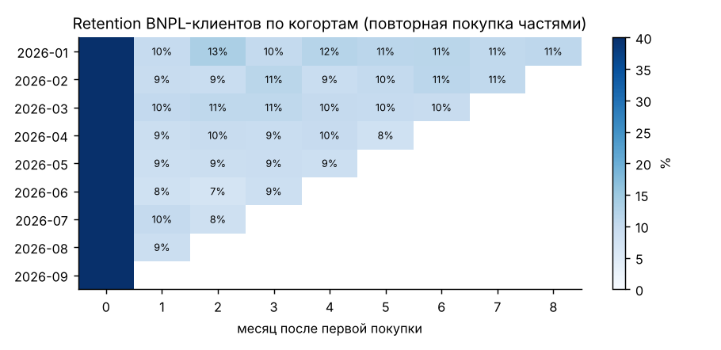
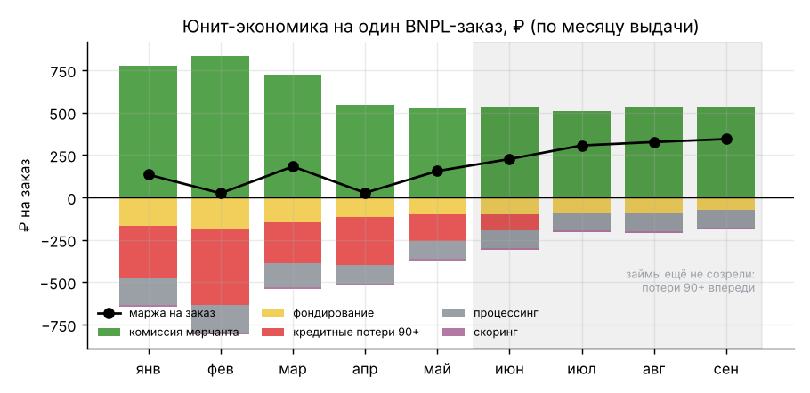
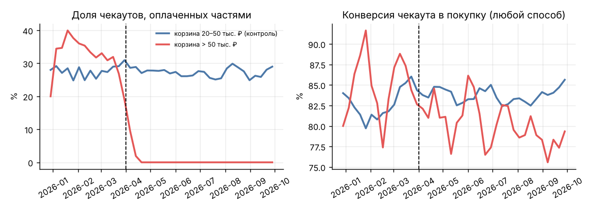

# SplitLab

Продуктовая аналитика сервиса «оплата частями» (BNPL) внутри маркетплейса, по аналогии с Яндекс Сплитом и Долями. Четыре вопроса, которые были у таких команд в 2026 году:

1. Как выглядят аудитория, воронка и удержание?
2. Зарабатывает ли сервис на одном заказе и что съедает маржу?
3. Сколько стоило отключение рассрочки для корзин дороже 50 000 ₽?
4. Стоит ли показывать «4 × N ₽» прямо на карточке товара?

<p align="center"></p>

## Контекст

С 1 апреля 2026 года действует 283-ФЗ: BNPL-операторы входят в реестр Банка России, скрытые комиссии запрещены, а сведения о рассрочках дороже 50 000 ₽ передаются в бюро кредитных историй ([Контур](https://kontur.ru/articles/513), [Альфа-Банк](https://kurs.alfabank.ru/articles/zakon-o-servisah-rassrochki-chto-menyaetsya-po-283-fz/)). В части публикаций этот порог описывают как лимит покупки, поэтому сервисам пришлось решать, что делать с дорогими корзинами. Оборот рынка в 2026 году оценивают в 1,2–1,25 трлн ₽ ([ComNews](https://www.comnews.ru/content/244388/2026-03-25/2026-w13/1008/seroy-zony-k-regulirovaniyu-chto-zhdet-bnpl-servisy-posle-1-aprelya-2026-g), [Код Дурова](https://kod.ru/bnpl-rynok-rassrochek-rus)), при этом классические POS-кредиты в 2025 году сократились на 52%.

## Данные

[Генератор](src/generate_data.py) создаёт лог маркетплейса за январь–сентябрь 2026 года (срез на 15 октября): 60 000 пользователей, 1 млн событий, 82 тыс. заказов, 19 тыс. займов и 76 тыс. платежей по графику. В данные заложены сценарий «с 1 апреля сервис перестаёт предлагать рассрочку для корзин дороже 50 000 ₽», A/B-тест в августе и просрочки (часть должников возвращается через взыскание).

Таблицы: `users`, `events` (session_start → checkout_start → bnpl_offer_shown → bnpl_selected → bnpl_approved / bnpl_declined → order_paid), `orders`, `installments`, `ab_assignments`.

## 1. Метрики, воронка, когорты

SQL лежит в [`sql/`](sql/). WAU и MAU считаются как уникальные пользователи в скользящем окне, а не как сумма DAU.

| Метрика | Значение |
|---|---|
| DAU / MAU | 2 520 / 29 140 |
| Stickiness | 8,7% (средняя по дням) — нормально для маркетплейса, где покупают не каждый день |
| Кому показали «частями» на чекауте | 97,8% (после закона ~97%: корзины дороже 50 000 ₽ выпали) |
| Выбрали «частями» | 25,1% от показов |
| Одобрил скоринг | 77,5% |
| Чекаут → покупка частями | 19,0% |
| Retention BNPL-клиентов на 1-й / 3-й месяц | 9,3% / 9,9% |

<p align="center"> </p>

Больше всего людей теряется на шаге «выбрали частями» (25%), а скоринг отсекает только 22,5% заявок. Значит, расти нужно не за счёт смягчения риск-политики, а за счёт того, чтобы рассказать о рассрочке раньше чекаута. Из этого вывода и выросла гипотеза для A/B-теста.

## 2. Юнит-экономика

Доход — комиссия мерчанта 6%. Расходы — фондирование (18% годовых за время, пока деньги на балансе), потери от неоплаты больше 90 дней, процессинг 1,2% и скоринг 8 ₽ за заявку. Допущения собраны в [`src/common.py`](src/common.py).

| По созревшим займам, январь–май | |
|---|---|
| Средний чек | 11 074 ₽ |
| Кредитные потери | 2,48% от оборота |
| Маржа на заказ | **108 ₽** (0,98% оборота) |

<p align="center"></p>

Потери съедают около 40% комиссии. Если снизить их на 0,5 п.п., маржа вырастет наполовину. Июнь–сентябрь на графике выглядят прибыльнее, но только потому, что просрочка 90+ по ним ещё не наступила. Сравнивать можно только созревшие месяцы выдачи.

## 3. Сколько стоило отключение рассрочки для корзин дороже 50 000 ₽

Сравнение «до/после» здесь не работает: сервис растёт, и после апреля оборот рассрочки всё равно вырос. Поэтому я использовал difference-in-differences: корзины 50–150 тыс. ₽ (изменение их затронуло) против корзин 20–50 тыс. ₽ (не затронуло). Корзины дороже 150 тыс. не берутся: их мало, и они плохо сравнимы с контролем. Регрессия с эффектами категорий и кластеризацией ошибок по пользователю: [`src/regulation_impact.py`](src/regulation_impact.py).

| Эффект для корзин > 50 000 ₽ | Оценка | 95% ДИ | p |
|---|---:|---|---:|
| Доля оплаты частями | −32,0 п.п. | [−36,4; −27,7] | <0,001 |
| Конверсия чекаута в покупку любым способом | −5,3 п.п. | [−9,2; −1,5] | 0,007 |

<p align="center"></p>

Деньги посчитаны из тех же DiD-оценок: эффект умножен на оборот дорогих корзин после 1 апреля (157 млн ₽ за 27 недель). Рассрочка потеряла около **50 млн ₽** оборота, а маркетплейс в целом — около **8,4 млн ₽**: примерно **83%** покупателей дорогих товаров заплатили другим способом, и реальная потеря в 6 раз меньше, чем видно по продукту рассрочки. Отсюда два шага: продукту рассрочки нужен отдельный сценарий для корзин дороже 50 тыс. (например, кредит банка-партнёра), а маркетплейсу — работа с брошенными дорогими корзинами.

## 4. A/B-тест «рассрочка на карточке товара»

3–30 августа 2026, рандомизация по пользователю через хеш с солью эксперимента, 50/50: [`src/ab_test.py`](src/ab_test.py).

| Проверка | Результат |
|---|---|
| Sample ratio mismatch | 18 033 / 17 888, p = 0,44 — сплит в порядке |
| Мощность | MDE ≈ 11,5% от базы 6,2% (α = 0,05, мощность 80%) |
| **Конверсия в покупку частями** | **6,20% → 7,13%, +15,1%**, ДИ [+0,42; +1,45] п.п., p = 0,0004 |
| Оборот рассрочки на пользователя | +7,3% (p = 0,24), с CUPED +8,1% (p = 0,18), с винсоризацией +7,8% (p = 0,20) — не значимо |
| Guardrail: конверсия в любую покупку | +2,5%, p = 0,17 — каннибализации нет |
| Guardrail: просрочка первого платежа 30+ | 2,00% → 1,47%, ДИ [−1,54; +0,49] п.п. — ухудшения не видно, но займов мало |

Что здесь важно:

- **CUPED почти не помог** (−1,4% дисперсии), хотя ковариат было четыре и история шла за полгода. Корреляция «до/после» всего 0,06–0,10, потому что оборот определяют редкие крупные покупки. Чтобы увидеть такой эффект по обороту, нужно примерно в 5 раз больше трафика, поэтому эта метрика не годится в основные для четырёхнедельного теста.
- **Просрочка — ratio-метрика** (просрочки / займы), а рандомизация идёт по пользователям, поэтому дисперсия считается дельта-методом.
- **Подглядывание:** в A/A-симуляции ежедневная проверка p-value даёт 27% ложных «побед» вместо 5%. Поэтому горизонт фиксируется заранее.

**Решение:** раскатить на 90% и оставить 10% контроля на три месяца, пока не созреют займы и не наберётся мощность для оборота.

## Запуск

Нужен Python 3.10+.

**macOS / Linux**
```bash
git clone https://github.com/antonshkelll/splitlab-bnpl-analytics.git
cd splitlab-bnpl-analytics
python3 -m venv .venv && source .venv/bin/activate
pip install -r requirements.txt
bash run_all.sh       # данные → витрины → DiD → A/B, ~20 сек
pytest -q             # проверка статистики симуляциями
```

**Windows (PowerShell)**
```powershell
git clone https://github.com/antonshkelll/splitlab-bnpl-analytics.git
cd splitlab-bnpl-analytics
py -m venv .venv; .venv\Scripts\Activate.ps1
pip install -r requirements.txt
python src/generate_data.py; python src/marts.py; python src/regulation_impact.py; python src/ab_test.py
```

Витрины для BI сохраняются в [`marts/`](marts/) в CSV, и их можно сразу подключить к Yandex DataLens или Superset.

## Ограничения

- Данные синтетические: проверяются методы, а не цифры конкретного сервиса.
- Ставка фондирования, комиссия и стоимость скоринга — допущения.
- DiD держится на допущении о параллельных трендах. До апреля тренды близки, но формально нужен placebo-тест на фиктивной дате.

## Стек

SQL (DuckDB: CTE, оконные функции, FILTER, скользящие окна) · pandas · SciPy · statsmodels · matplotlib
